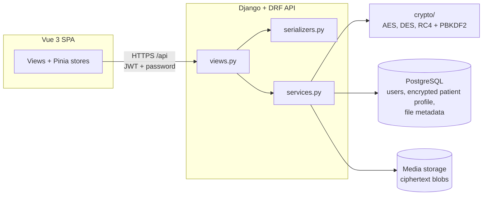
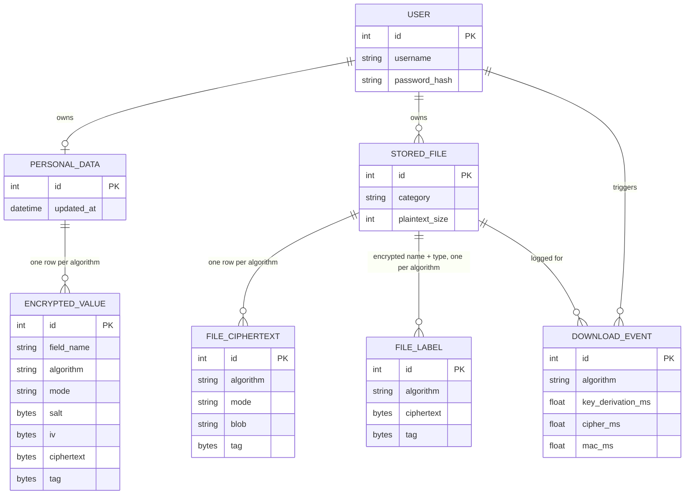
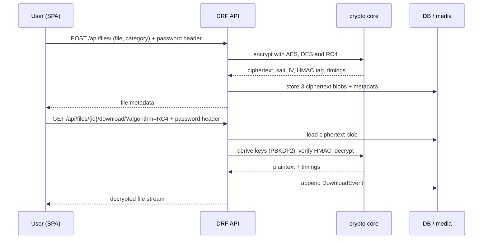

# Cipher Safe Backend

Django + DRF backend for **Cipher Safe**, a **patient-held medical records
vault**. Patients in Indonesia move between Puskesmas, clinics and hospitals
that do not share records, so they end up carrying their own history: KTP and
BPJS cards, lab results, referral letters and imaging videos handed out on a
disc or flash drive, often kept as photos in a chat app. Cipher Safe gives the
patient one place to keep that history and get it back at the next
appointment, with every item **encrypted with AES, DES and RC4** and readable
only by the patient who owns it.

Health data is a specific / special category under UU PDP Art. 4(2) and GDPR
Art. 9, so a leak of this store is high-impact by law; that is the reason the
data is encrypted at rest and integrity-checked on the way out.

## What a patient stores

| Item | Examples | Stored as |
| --- | --- | --- |
| Patient profile | name, NIK, BPJS number, date of birth, address, phone, emergency contact, blood type, allergies, chronic conditions, medications | one encrypted JSON record per algorithm |
| Identity / insurance scan | KTP, BPJS card | encrypted file (`ID_CARD`) |
| Medical document | lab result PDF, referral letter DOC, blood-sugar / medication log XLS | encrypted file (`DOCUMENT`) |
| Medical video | ultrasound, echocardiogram, endoscopy recording | encrypted file (`VIDEO`) |

File names and types are encrypted too, because a name like `HIV-test.pdf`
reveals health data on its own. Only the category, size and upload date stay in
the clear, so the vault can list and filter records.

## Features

- **Username + password** authentication with **JWT** access + refresh tokens.
- Everything above is encrypted with **all three** algorithms; file
  ciphertext lives on disk under `media/`.
- **Integrity**: every ciphertext carries an **HMAC-SHA256** tag
  (encrypt-then-MAC) that is verified before decryption, so data comes back
  intact or not at all (HTTP 409).
- **One mode per block cipher**: **CTR** for both AES and DES; RC4 is a stream
  cipher and has no mode. The other non-ECB modes (CBC, CFB, OFB) remain in the
  cipher core for the benchmark.
- **Timing analysis**: every download is logged with key-derivation, MAC and
  cipher time; a benchmark endpoint and an aggregate endpoint support the report.

## Architecture



## Data model



## Request flow



## Crypto design

| Concern | Decision |
| --- | --- |
| Key derivation | **PBKDF2-HMAC-SHA256**, 600,000 iterations, random 16-byte salt per operation; one derivation yields the cipher key and a separate 32-byte MAC key |
| Key source | The user's **password** (never stored); verified against the Django password hash before any crypto work |
| AES | AES-**256**-**GCM** (AEAD: its own 128-bit tag, parameters bound as associated data; CBC/CFB-128/OFB/CTR available to the benchmark) |
| DES | DES-**CTR** (legacy, required by the assignment) |
| RC4 | RC4 stream cipher (legacy, for comparison only) |
| Integrity | AES: the **GCM tag**. DES/RC4: **HMAC-SHA256** over version, algorithm, mode, salt, IV and ciphertext, checked in constant time before decrypting |
| Padding | none in GCM/CTR/RC4; PKCS#7 only if CBC is benchmarked |
| Storage | salt + IV + tag per ciphertext; one row/blob per algorithm |

For a full implementation walkthrough with code, see
[`docs/encryption.md`](docs/encryption.md).

> The password is sent on crypto requests via the `X-Cipher-Password` header
> (the request body is also accepted). Over HTTPS this is equivalent to any other
> credential submission. The query string is deliberately not accepted, since
> URLs are recorded in access logs, browser history and `Referer` headers.

## User key pairs

Every account (patient or doctor) can have **RSA key pairs**, one active pair
per purpose: `ENCRYPTION` (the public key encrypts keys of records shared with
the user) and `SIGNING` (the private key signs the user's PDFs). A pair is
generated on first use and can be rotated; the old pair stays, inactive.

| Item | Value |
| --- | --- |
| Algorithm | RSA-3072, public exponent 65537 (`cryptography`) |
| Fingerprint | SHA-256 of the DER public key, shown as `AB:CD:...` |
| Private key at rest | PKCS#8, encrypted with **AES-256-GCM**; never stored in the clear |
| Key-encryption key | PBKDF2-HMAC-SHA256 of the user's password, 600,000 rounds, random 16-byte salt per pair |
| Associated data | `cipher-safe/keypair:<user id>:<purpose>`, so a stored key can't be moved to another user or purpose |
| In use | Decrypted in memory, for one request, with the password the client sends |
| Signing certificate | Self-signed X.509 v3, `CN=<username>, O=Cipher Safe`, valid 3 years, `CA:FALSE`, key usage digital signature + non-repudiation, extended key usage document signing; for signing pairs the fingerprint is the certificate's SHA-256 |

Changing the password would need every private key re-wrapped; there is no
password change, so this is a known limitation.

## Sharing through access requests

Any user can ask any other user for their data; the owner decides what to
share and for how long. Accounts are still labelled **patient** (owns a vault)
or **doctor**, but both can ask and be asked.

1. **Request:** the requester names the owner, with an optional message and a
   hint (a record category or the profile). File names stay encrypted, so the
   requester can't pick a file.
2. **Approve:** the owner picks records and/or a snapshot of their profile and
   a period (1 hour to 1 week). For each item the server makes a random
   **AES-256 key**, stores a separate copy encrypted with **AES-256-GCM** under
   it, and encrypts the key with the requester's public key (**RSA-OAEP**,
   SHA-256). The result is an *envelope*, `CSK1.<request>.<item>.<base64url>`.
3. **Send:** the owner sends each envelope outside the app (WhatsApp, email).
   Only the requester's private key opens it, so the channel doesn't need to be
   secret.
4. **Redeem:** the requester pastes the envelope; the server checks its hash,
   opens it with their private key (unlocked with their password) and keeps the
   item key encrypted for them.
5. **End:** the owner can stop access at any time (copies and keys deleted).
   After the period every item endpoint returns 404, and
   `python manage.py purge_expired_grants` deletes the expired copies and keys;
   run it regularly (e.g. from cron).

What is stored, per item: the encrypted copy; the item key encrypted for the
owner (and, after redeeming, for the requester) with a key derived from that
user's password; the envelope encrypted for the owner, so the same one can be
shown again; and the envelope's SHA-256. The item key and the envelope are
never stored in the clear.

## Setup

### 1. Create `.env` and generate its secrets

```bash
cp .env.example .env
```

Two values must be generated, and each person uses their own:

| Variable | What it is | Generate with |
| --- | --- | --- |
| `DJANGO_SECRET_KEY` | Signs login tokens (JWT) and sessions | see below |
| `POSTGRES_PASSWORD` | Password of the local database | see below |

```bash
# With Python installed
python3 -c "import secrets; print(secrets.token_urlsafe(50))"   # DJANGO_SECRET_KEY
python3 -c "import secrets; print(secrets.token_urlsafe(24))"   # POSTGRES_PASSWORD

# With only Docker installed
docker run --rm python:3.12-slim python -c "import secrets; print(secrets.token_urlsafe(50))"
docker run --rm python:3.12-slim python -c "import secrets; print(secrets.token_urlsafe(24))"
```

Paste each output into `.env`. Notes:

- **Set `POSTGRES_PASSWORD` before the first `docker compose up`.** Postgres
  stores it when the database is first created; changing it later needs
  `docker compose down -v`, which deletes the data.
- **Keep `DJANGO_SECRET_KEY` stable.** Changing it logs everyone out. It does not
  encrypt the records: those are encrypted with each user's own password.
- Never commit `.env` (it is gitignored).

### 2a. Run with Docker (recommended)

Needs only Docker. Python, its locked dependencies and PostgreSQL all run in
containers.

```bash
docker compose pull         # download the API image CI built from main
docker compose up
```

Changed the backend code or its dependencies? Build your own image instead:
`docker compose up --build`.

The API is at <http://localhost:8000/api/>. Migrations run automatically on
start, and code changes reload the server. Then start the frontend (see the
`cipher-safe-frontend` README).

```bash
docker compose exec api python manage.py createsuperuser   # admin account (/admin/)
docker compose exec api python manage.py test core         # run the tests
docker compose down          # stop (data is kept in the postgres_data volume)
docker compose down -v       # stop and delete all data
```

If port 5432 or 8000 is taken, set `POSTGRES_PORT` or `API_PORT` in `.env`.

### 2b. Run without Docker

Needs Python 3.12+, [uv](https://docs.astral.sh/uv/) and a PostgreSQL server
(for example `docker compose up -d db`).

```bash
uv sync                   # creates .venv from uv.lock
uv run python manage.py migrate
uv run python manage.py createsuperuser
uv run python manage.py runserver
```

Run the tests:

```bash
uv run python manage.py test core
```

## API

All endpoints are under `/api/`. Authenticated calls send
`Authorization: Bearer <access>`; crypto calls also send `X-Cipher-Password`.
Access tokens are short-lived (15 minutes); exchange the refresh token at
`/api/auth/refresh/` for a new pair.

| Method | Path | Purpose |
| --- | --- | --- |
| POST | `/api/auth/register/` | Create a user (`role`: `PATIENT` default, or `DOCTOR`), returns `access`, `refresh` and `user` |
| POST | `/api/auth/login/` | Obtain `access` + `refresh` tokens |
| POST | `/api/auth/refresh/` | Exchange a refresh token for a new pair |
| POST | `/api/auth/logout/` | Blacklist the supplied refresh token |
| GET | `/api/me/` | Current user |
| GET | `/api/me/keys/` | My active key pairs: purpose, algorithm, fingerprint, public key (never the private key) |
| POST | `/api/me/keys/` | Generate a pair (`purpose`: `ENCRYPTION` or `SIGNING`; `rotate`: replace the active one); needs the password; 201 new, 200 existing |
| GET | `/api/users/{username}/public-key/?purpose=ENCRYPTION` | Another user's active public key and fingerprint; 404 if they have none |
| GET | `/api/me/keys/certificate/` | Download my signing certificate (`cipher-safe-<username>.cer`, DER); 404 without a signing key |
| GET | `/api/users/{username}/certificate/` | Anyone's signing certificate, to trust it in a PDF reader; 404 if they have none |
| GET | `/api/me/personal-data/?algorithm=AES` | Decrypt the patient profile |
| PUT | `/api/me/personal-data/` | Replace the patient profile (encrypted with AES/DES/RC4) |
| GET | `/api/files/?category=VIDEO` | List files (metadata only) |
| POST | `/api/files/` | Upload (`file`, `category`, optional `sign=true`); encrypts with all algorithms. With `sign=true` a PDF is first signed with the uploader's signing key (created on first use), then the signed file is encrypted; 400 if it isn't a PDF, 409 if already signed |
| GET | `/api/files/{id}/` | File metadata + per-algorithm ciphertext info |
| DELETE | `/api/files/{id}/` | Delete a file |
| GET | `/api/files/{id}/download/?algorithm=DES&inline=1` | Decrypt and download; `inline=1` serves safe types (PDF, images, video, text) for in-browser preview |
| GET | `/api/files/{id}/ciphertext/?algorithm=DES` | Download the stored copy as-is (ciphertext), keeping the original extension (`lab.DES-encrypted.pdf`); needs the password |
| GET | `/api/files/{id}/benchmark/?algorithm=AES&runs=10` | N timed decryptions (total and cipher-only samples) |
| POST | `/api/access-requests/` | Ask a user for their data (`owner`, optional `message`, `category`: a record category or `PROFILE`); any role to any role; one pending request per pair |
| GET | `/api/access-requests/?box=incoming` | Requests to me (`incoming`, default) or from me (`outgoing`), newest first; approved ones list their `items` (id, kind, category, redeemed, access count; never names or content) |
| POST | `/api/access-requests/{id}/deny/` | Owner refuses a pending request |
| DELETE | `/api/access-requests/{id}/` | Requester cancels a pending request (`CANCELLED`); owner revokes an approved one (`REVOKED`, every granted copy and key deleted); 404 if you're not part of the request, 409 if the status doesn't allow it |
| POST | `/api/access-requests/{id}/approve/` | Owner grants a pending request (`file_ids`, `include_profile`, `expires_hours` 1-168); needs the password; returns one envelope per item (the item key encrypted with the requester's RSA public key), with its `file_id` and the requester's key fingerprint; 409 if the requester has no encryption key yet |
| GET | `/api/access-requests/{id}/items/{item_id}/envelope/` | Owner shows an item's envelope again (the same text); needs the password |
| POST | `/api/access-requests/{id}/items/{item_id}/redeem/` | Requester enters the envelope (`envelope`); needs their password; 400 malformed or for another item, 403 not this item's envelope, 409 can't be opened; throttled |
| GET | `/api/access-requests/{id}/items/{item_id}/?inline=1` | Requester opens a redeemed item: the record, or the profile snapshot as JSON; needs their password; 404 after expiry or revocation |
| GET | `/api/analysis/downloads/` | Download history with timings |
| GET | `/api/analysis/timings/` | Aggregate timings per algorithm |

### Example

```bash
ACCESS=$(curl -s -X POST localhost:8000/api/auth/login/ \
  -H 'Content-Type: application/json' \
  -d '{"username":"alice","password":"SuperSecret123!"}' | jq -r .access)

curl -X POST localhost:8000/api/files/ \
  -H "Authorization: Bearer $ACCESS" \
  -H "X-Cipher-Password: SuperSecret123!" \
  -F category=VIDEO -F file=@ultrasound.mp4

curl -o ultrasound.mp4 localhost:8000/api/files/1/download/?algorithm=RC4 \
  -H "Authorization: Bearer $ACCESS" \
  -H "X-Cipher-Password: SuperSecret123!"
```

## Layout

```text
config/            Django project (settings, urls)
core/
  constants.py     algorithm/mode choices derived from the crypto layer
  crypto/          AES / DES / RC4 primitives + PBKDF2 key derivation
  models.py        User, PersonalData, EncryptedValue, StoredFile,
                   FileCiphertext, DownloadEvent
  serializers.py   DRF serializers (never expose salt/IV/ciphertext)
  services.py      encryption/decryption orchestration
  views.py         API views
  tests/           crypto + API test suite (split by area)
  migrations/      schema history
```

## Credits

The symmetric-cipher core in [`core/crypto/`](core/crypto) is adapted from the
lab reference implementation
[`ukassu/lab-session-information-security`](https://github.com/ukassu/lab-session-information-security)
(`crypto_tool.py`): PBKDF2-HMAC-SHA256 key derivation, PKCS#7 padding, and
AES-256-CBC / DES-CBC / RC4 encryption.

What this project changed on top of the reference:

- Added the **CFB, OFB and CTR** modes of operation for AES and DES (the
  reference implemented CBC only), with CTR as the mode used for stored data.
- Added **encrypt-then-MAC** (HMAC-SHA256) so tampering and wrong keys are
  detected in every mode.
- Split the single-file tool into a framework-free `crypto/` package
  (`keys.py` + `algorithms.py`) plus Django models and a service layer.
- Replaced the JSON file envelope with database-backed `EncryptionEnvelope`
  rows and media blobs, and added per-operation timing.

The upstream repository does not declare a license, so it is credited here and
this project's reuse is limited to the derived cipher core.
