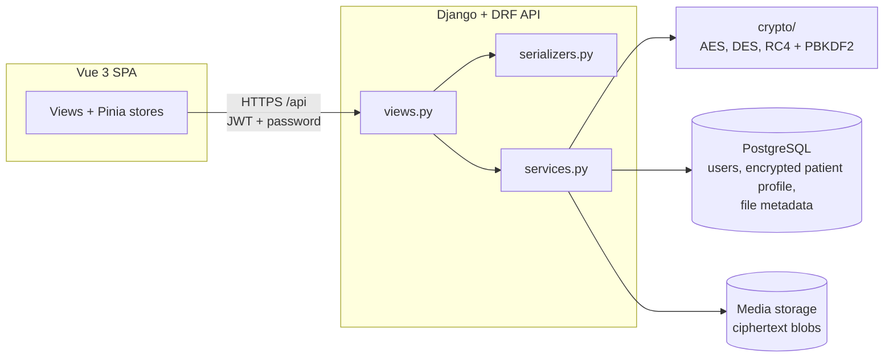
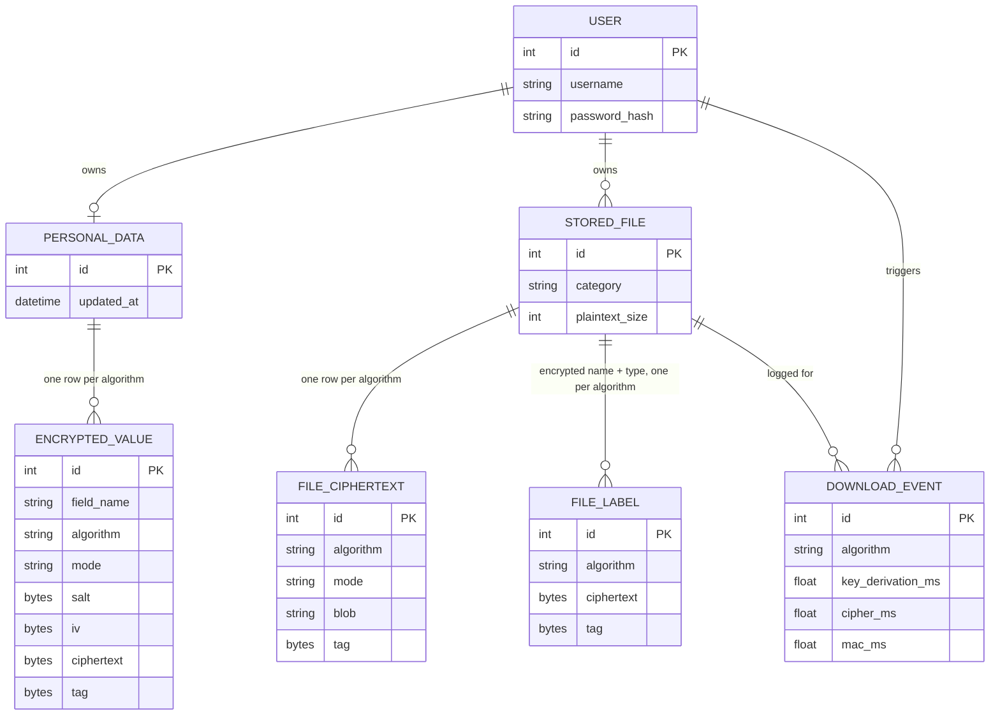
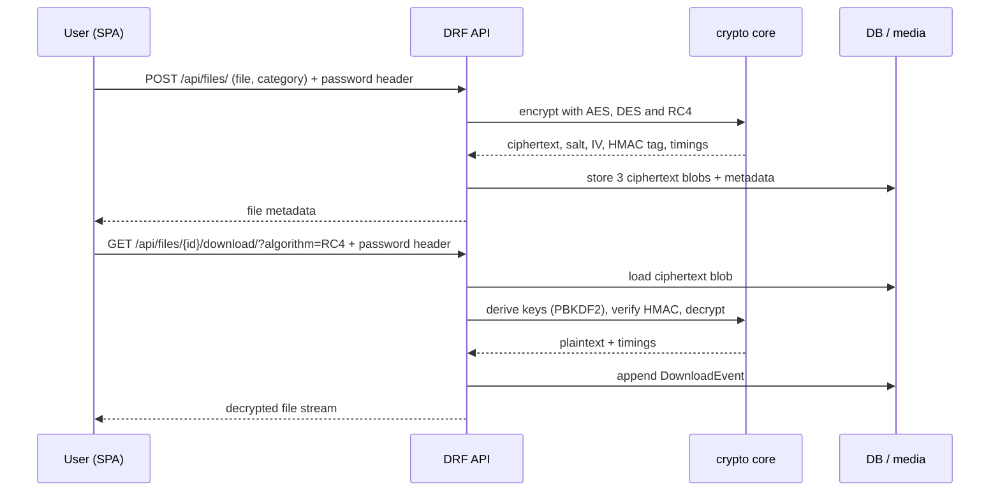

# Cipher Safe Backend

Django + DRF backend for **Cipher Safe**, a **patient-held medical records
vault**. Patients in Indonesia move between Puskesmas, clinics and hospitals
that do not share records, so they end up carrying their own history: KTP and
BPJS cards, lab results, referral letters and imaging videos handed out on a
disc or flash drive, often kept as photos in a chat app. Cipher Safe gives the
patient one place to keep that history and get it back at the next
appointment, with every item **encrypted with AES, DES and RC4** and readable
only by the patient who owns it.

Health data is a specific / special category under UU PDP Art. 4(2) and GDPR
Art. 9, so a leak of this store is high-impact by law; that is the reason the
data is encrypted at rest and integrity-checked on the way out.

## What a patient stores

| Item | Examples | Stored as |
| --- | --- | --- |
| Patient profile | name, NIK, BPJS number, date of birth, address, phone, emergency contact, blood type, allergies, chronic conditions, medications | one encrypted JSON record per algorithm |
| Identity / insurance scan | KTP, BPJS card | encrypted file (`ID_CARD`) |
| Medical document | lab result PDF, referral letter DOC, blood-sugar / medication log XLS | encrypted file (`DOCUMENT`) |
| Medical video | ultrasound, echocardiogram, endoscopy recording | encrypted file (`VIDEO`) |

File names and types are encrypted too, because a name like `HIV-test.pdf`
reveals health data on its own. Only the category, size and upload date stay in
the clear, so the vault can list and filter records.

## Features

- **Username + password** authentication with **JWT** access + refresh tokens.
- Everything above is encrypted with **all three** algorithms; file
  ciphertext lives on disk under `media/`.
- **Integrity**: every ciphertext carries an **HMAC-SHA256** tag
  (encrypt-then-MAC) that is verified before decryption, so data comes back
  intact or not at all (HTTP 409).
- **One mode per block cipher**: **CTR** for both AES and DES; RC4 is a stream
  cipher and has no mode. The other non-ECB modes (CBC, CFB, OFB) remain in the
  cipher core for the benchmark.
- **Timing analysis**: every download is logged with key-derivation, MAC and
  cipher time; a benchmark endpoint and an aggregate endpoint support the report.

## Architecture



## Data model



## Request flow



## Crypto design

| Concern | Decision |
| --- | --- |
| Key derivation | **PBKDF2-HMAC-SHA256**, 600,000 iterations, random 16-byte salt per operation; one derivation yields the cipher key and a separate 32-byte MAC key |
| Key source | The user's **password** (never stored); verified against the Django password hash before any crypto work |
| AES | AES-**256**-**CTR** (CBC/CFB-128/OFB available to the benchmark) |
| DES | DES-**CTR** (legacy, required by the assignment) |
| RC4 | RC4 stream cipher (legacy, for comparison only) |
| Integrity | **HMAC-SHA256** over version, algorithm, mode, salt, IV and ciphertext; checked in constant time before decrypting |
| Padding | none in CTR/RC4; PKCS#7 only if CBC is benchmarked |
| Storage | salt + IV + tag per ciphertext; one row/blob per algorithm |

For a full implementation walkthrough with code, see
[`docs/encryption.md`](docs/encryption.md).

> The password is sent on crypto requests via the `X-Cipher-Password` header
> (the request body is also accepted). Over HTTPS this is equivalent to any other
> credential submission. The query string is deliberately not accepted, since
> URLs are recorded in access logs, browser history and `Referer` headers.

## Setup

Requires Python 3.12+ and a PostgreSQL instance (`docker-compose up -d db`).

```bash
# with uv (recommended)
uv sync

# or a plain venv
python -m venv .venv && . .venv/bin/activate && pip install -e .

cp .env.example .env      # fill in the Postgres values + DJANGO_SECRET_KEY
python manage.py migrate
python manage.py createsuperuser
python manage.py runserver
```

Run the tests:

```bash
python manage.py test core
```

## API

All endpoints are under `/api/`. Authenticated calls send
`Authorization: Bearer <access>`; crypto calls also send `X-Cipher-Password`.
Access tokens are short-lived (15 minutes); exchange the refresh token at
`/api/auth/refresh/` for a new pair.

| Method | Path | Purpose |
| --- | --- | --- |
| POST | `/api/auth/register/` | Create a user, returns `access`, `refresh` and `user` |
| POST | `/api/auth/login/` | Obtain `access` + `refresh` tokens |
| POST | `/api/auth/refresh/` | Exchange a refresh token for a new pair |
| POST | `/api/auth/logout/` | Blacklist the supplied refresh token |
| GET | `/api/me/` | Current user |
| GET | `/api/me/personal-data/?algorithm=AES` | Decrypt the patient profile |
| PUT | `/api/me/personal-data/` | Replace the patient profile (encrypted with AES/DES/RC4) |
| GET | `/api/files/?category=VIDEO` | List files (metadata only) |
| POST | `/api/files/` | Upload (`file`, `category`); encrypts with all algorithms |
| GET | `/api/files/{id}/` | File metadata + per-algorithm ciphertext info |
| DELETE | `/api/files/{id}/` | Delete a file |
| GET | `/api/files/{id}/download/?algorithm=DES` | Decrypt and download |
| GET | `/api/files/{id}/ciphertext/?algorithm=DES` | Download the stored copy as-is (ciphertext) |
| GET | `/api/files/{id}/benchmark/?algorithm=AES&runs=10` | N timed decryptions |
| GET | `/api/analysis/downloads/` | Download history with timings |
| GET | `/api/analysis/timings/` | Aggregate timings per algorithm |

### Example

```bash
ACCESS=$(curl -s -X POST localhost:8000/api/auth/login/ \
  -H 'Content-Type: application/json' \
  -d '{"username":"alice","password":"SuperSecret123!"}' | jq -r .access)

curl -X POST localhost:8000/api/files/ \
  -H "Authorization: Bearer $ACCESS" \
  -H "X-Cipher-Password: SuperSecret123!" \
  -F category=VIDEO -F file=@ultrasound.mp4

curl -o ultrasound.mp4 localhost:8000/api/files/1/download/?algorithm=RC4 \
  -H "Authorization: Bearer $ACCESS" \
  -H "X-Cipher-Password: SuperSecret123!"
```

## Layout

```
config/            Django project (settings, urls)
core/
  constants.py     algorithm/mode choices derived from the crypto layer
  crypto/          AES / DES / RC4 primitives + PBKDF2 key derivation
  models.py        User, PersonalData, EncryptedValue, StoredFile,
                   FileCiphertext, DownloadEvent
  serializers.py   DRF serializers (never expose salt/IV/ciphertext)
  services.py      encryption/decryption orchestration
  views.py         API views
  tests/           crypto + API test suite (split by area)
  migrations/      schema history
```

## Credits

The symmetric-cipher core in [`core/crypto/`](core/crypto) is adapted from the
lab reference implementation
[`ukassu/lab-session-information-security`](https://github.com/ukassu/lab-session-information-security)
(`crypto_tool.py`): PBKDF2-HMAC-SHA256 key derivation, PKCS#7 padding, and
AES-256-CBC / DES-CBC / RC4 encryption.

What this project changed on top of the reference:

- Added the **CFB, OFB and CTR** modes of operation for AES and DES (the
  reference implemented CBC only), with CTR as the mode used for stored data.
- Added **encrypt-then-MAC** (HMAC-SHA256) so tampering and wrong keys are
  detected in every mode.
- Split the single-file tool into a framework-free `crypto/` package
  (`keys.py` + `algorithms.py`) plus Django models and a service layer.
- Replaced the JSON file envelope with database-backed `EncryptionEnvelope`
  rows and media blobs, and added per-operation timing.

The upstream repository does not declare a license, so it is credited here and
this project's reuse is limited to the derived cipher core.
