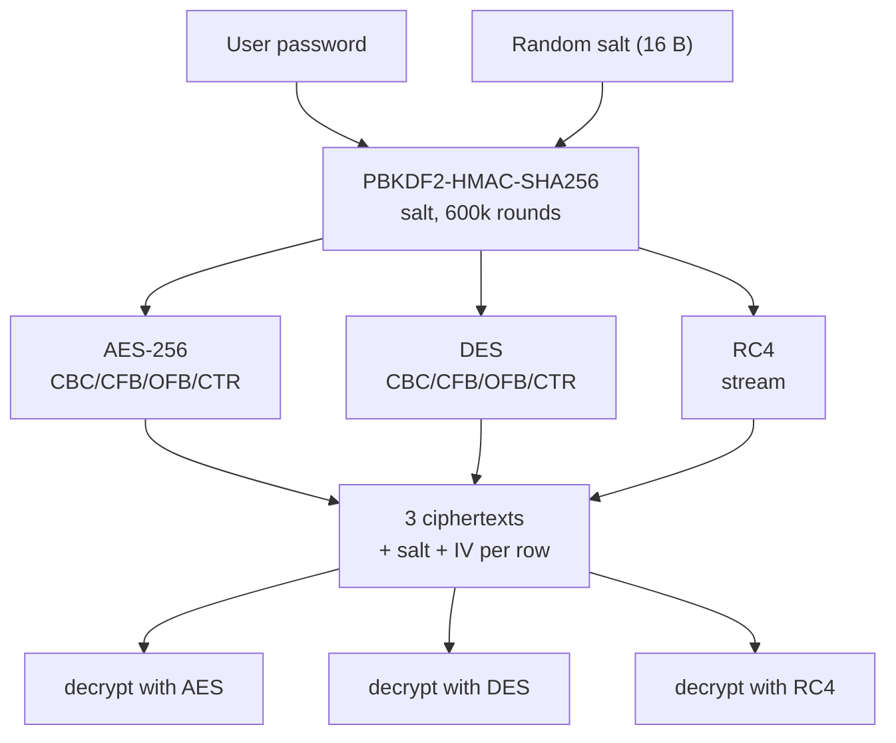

# Implementing AES, DES and RC4 Encryption

This guide explains how Cipher Safe performs symmetric encryption with the
three required algorithms (**AES**, **DES** and **RC4**), why each decision was
made, and how the pieces fit together. The working code lives in
[`core/crypto/`](../core/crypto) and is wired to the database in
[`core/services.py`](../core/services.py).

## Origin

The cipher core is adapted from the lab reference implementation
[`ukassu/lab-session-information-security`](https://github.com/ukassu/lab-session-information-security)
(`crypto_tool.py`), which provides the PBKDF2 key derivation, PKCS#7 padding and
AES-256-CBC / DES-CBC / RC4 primitives. This project extends it with the CFB,
OFB and CTR modes and restructures it into a framework-free `core/crypto/`
package.

## Design goals

- Derive every key from the user's **password** (never store a key).
- Store each item **three times**, once per algorithm, so the same data can be
  decrypted with any of them.
- Use a **non-ECB** block mode for the block ciphers.
- Keep the primitives **framework-free** so they can be unit-tested in isolation.
- Record **timing** for each operation so the algorithms can be compared.

## Dependencies

The ciphers come from [PyCryptodome](https://pycryptodome.readthedocs.io/):

```bash
pip install pycryptodome
```

```python
from Crypto.Cipher import AES, ARC4, DES
from Crypto.Util import Counter
from Crypto.Protocol.KDF import PBKDF2
from Crypto.Hash import SHA256
```

## 1. Key derivation (PBKDF2-HMAC-SHA256)

A password is not usable as a raw key: AES needs 32 bytes, DES needs 8, and a
password can be any length. So each operation derives a key with
**PBKDF2-HMAC-SHA256**, using a **fresh random 16-byte salt**:

```python
import secrets
from Crypto.Protocol.KDF import PBKDF2
from Crypto.Hash import SHA256

SALT_SIZE = 16
PBKDF2_ROUNDS = 600_000

def new_salt() -> bytes:
    return secrets.token_bytes(SALT_SIZE)

def derive_key(password: str, salt: bytes, length: int) -> bytes:
    if not password:
        raise ValueError("Password must not be empty.")
    if len(salt) != SALT_SIZE:
        raise ValueError("Invalid salt size.")
    return PBKDF2(
        password, salt, dkLen=length, count=PBKDF2_ROUNDS, hmac_hash_module=SHA256
    )
```

- The 600,000 iterations make brute-forcing the password expensive.
- A new salt per operation means **the same password yields a different key
  every time**, so identical plaintexts never produce identical ciphertexts.
- `derive_key` is told the target length, so one function serves all three
  algorithms.

## 2. Algorithm parameters

| Algorithm | Type | Key size | Block / IV | Modes | Padding |
| --- | --- | --- | --- | --- | --- |
| AES | block cipher | 32 bytes (AES-256) | 16 bytes | CBC, CFB, OFB, CTR | PKCS#7 for CBC only |
| DES | block cipher | 8 bytes | 8 bytes | CBC, CFB, OFB, CTR | PKCS#7 for CBC only |
| RC4 | stream cipher | 32 bytes | none | none | none |

```python
SUPPORTED_ALGORITHMS = ("AES", "DES", "RC4")
SUPPORTED_MODES = ("CBC", "CFB", "OFB", "CTR")
DEFAULT_MODE = "CBC"

_KEY_SIZE = {"AES": 32, "DES": 8, "RC4": 32}
_BLOCK_SIZE = {"AES": AES.block_size, "DES": DES.block_size}
_IV_SIZE = {"AES": AES.block_size, "DES": DES.block_size}
```

## 3. AES

AES is what you should use in practice: `AES` with a 32-byte key is AES-256.
IV generation and mode selection are shared with DES (see below).

```python
iv = secrets.token_bytes(_IV_SIZE["AES"])          # 16 random bytes
key = derive_key(password, salt, _KEY_SIZE["AES"])  # 32 bytes
cipher = AES.new(key, AES.MODE_CBC, iv=iv)
ciphertext = cipher.encrypt(pkcs7_pad(data, AES.block_size))
```

## 4. DES

DES is implemented **only for comparison**; its 56-bit effective key and 8-byte
block are broken by modern standards. The code path is identical to AES with a
smaller key/block:

```python
iv = secrets.token_bytes(_IV_SIZE["DES"])          # 8 random bytes
key = derive_key(password, salt, _KEY_SIZE["DES"])  # 8 bytes
cipher = DES.new(key, DES.MODE_CBC, iv=iv)
ciphertext = cipher.encrypt(pkcs7_pad(data, DES.block_size))
```

## 5. RC4

RC4 is a **stream** cipher, so there is no mode of operation, no IV and no
padding: it XORs the plaintext with a keystream. It is also included only for
comparison (its keystream has known biases and it is insecure in modern use).

```python
key = derive_key(password, salt, _KEY_SIZE["RC4"])  # 32 bytes
ciphertext = ARC4.new(key).encrypt(data)            # no IV, no padding
```

## 6. Modes of operation

ECB is deliberately avoided: it encrypts identical blocks to identical
ciphertext, leaking structure. The block ciphers support CBC, CFB, OFB and CTR.

```python
def _block_cipher(algorithm: str, key: bytes, mode: str, iv: bytes):
    module = AES if algorithm == "AES" else DES
    if mode == "CBC":
        return module.new(key, module.MODE_CBC, iv=iv)
    if mode == "CFB":
        return module.new(key, module.MODE_CFB, iv=iv)
    if mode == "OFB":
        return module.new(key, module.MODE_OFB, iv=iv)
    if mode == "CTR":
        bits = _BLOCK_SIZE[algorithm] * 8
        counter = Counter.new(bits, initial_value=int.from_bytes(iv, "big"))
        return module.new(key, module.MODE_CTR, counter=counter)
    raise ValueError(f"Unsupported mode of operation: {mode}")
```

| Mode | Needs IV | Needs padding | Turns block cipher into |
| --- | --- | --- | --- |
| CBC | yes | yes | block mode |
| CFB | yes | no | stream |
| OFB | yes | no | stream |
| CTR | yes (used as nonce) | no | stream |

CTR has no built-in IV argument in PyCryptodome; the random IV is fed in as the
initial counter value.

## 7. Padding (PKCS#7, CBC only)

CBC requires the plaintext length to be a multiple of the block size. CFB, OFB,
CTR and a stream cipher like RC4 do not, so padding is applied **only for CBC**.

```python
def _pkcs7_pad(data: bytes, block_size: int) -> bytes:
    padding = block_size - len(data) % block_size
    return data + bytes([padding]) * padding

def _pkcs7_unpad(data: bytes, block_size: int) -> bytes:
    if not data or len(data) % block_size:
        raise ValueError("Invalid padding.")
    padding = data[-1]
    if padding < 1 or padding > block_size or data[-padding:] != bytes([padding]) * padding:
        raise ValueError("Invalid padding.")
    return data[:-padding]
```

Note that padding always adds at least one byte, so an input that is already a
multiple of the block size gets a full extra block.

## 8. Unified `encrypt` / `decrypt` API

One entry point per direction covers all three algorithms. It normalises the
arguments, derives the key, runs the cipher, and returns the parameters needed
to reverse the operation together with timing measurements.

```python
def encrypt(data, password, algorithm="AES", mode=DEFAULT_MODE) -> EncryptionResult:
    algorithm, mode = _normalise(algorithm, mode)
    salt = new_salt()

    start = time.perf_counter()
    key = derive_key(password, salt, _KEY_SIZE[algorithm])
    key_derivation_ms = (time.perf_counter() - start) * 1000

    start = time.perf_counter()
    iv = None
    if algorithm == "RC4":
        ciphertext = ARC4.new(key).encrypt(data)
    else:
        iv = secrets.token_bytes(_IV_SIZE[algorithm])
        cipher = _block_cipher(algorithm, key, mode, iv)
        payload = _pkcs7_pad(data, _BLOCK_SIZE[algorithm]) if mode == "CBC" else data
        ciphertext = cipher.encrypt(payload)
    cipher_ms = (time.perf_counter() - start) * 1000

    return EncryptionResult(algorithm, mode, salt, iv, ciphertext,
                            len(data), key_derivation_ms, cipher_ms)
```

`decrypt` mirrors this: derive the key from the stored salt, rebuild the cipher
from the stored IV and mode, decrypt, and unpad if CBC.

The result objects carry the timing split explicitly, because key derivation
(PBKDF2) dominates the cost and would otherwise hide the differences between the
ciphers:

```python
@dataclass(frozen=True)
class EncryptionResult:
    algorithm: str
    mode: str
    salt: bytes
    iv: bytes | None
    ciphertext: bytes
    plaintext_size: int
    key_derivation_ms: float
    cipher_ms: float

    @property
    def total_ms(self) -> float:
        return self.key_derivation_ms + self.cipher_ms
```

## 9. What must be stored per ciphertext

To decrypt later you need everything except the key: the algorithm, the mode,
the salt, the IV (block ciphers only) and the ciphertext. In Cipher Safe these
live on the `EncryptionEnvelope` model, which also keeps the timings:

| Field | Purpose |
| --- | --- |
| `algorithm` | which cipher to use |
| `mode` | CBC / CFB / OFB / CTR (blank for RC4) |
| `salt` | 16 bytes, needed to re-derive the key |
| `iv` | 16 or 8 bytes (null for RC4) |
| `ciphertext` | the encrypted bytes (or a file blob on disk) |
| `key_derivation_ms`, `cipher_ms` | timing for the analysis |

## 10. Wiring it into the app: three ciphertexts per item

The service layer encrypts every item with **all three** algorithms and stores
one row per algorithm:

```python
def encrypt_with_all_algorithms(data: bytes, password: str, mode: str = DEFAULT_MODE):
    return {
        algorithm: encrypt(data, password, algorithm=algorithm, mode=mode)
        for algorithm in SUPPORTED_ALGORITHMS
    }

def store_file_ciphertexts(stored_file, data, password, mode=DEFAULT_MODE):
    rows = []
    for algorithm, result in encrypt_with_all_algorithms(data, password, mode).items():
        row = FileCiphertext(file=stored_file)
        row.apply_result(result)  # copies algorithm/mode/salt/iv/timings/size
        row.blob.save(f"{stored_file.pk}-{algorithm}.bin", ContentFile(result.ciphertext), save=False)
        row.save()
        rows.append(row)
    return rows
```

Small personal-data fields use the same helper and store the ciphertext inline;
large files store it as a blob under `media/`.

## 11. Flow



## 12. Security notes and caveats

- **No authentication tag.** These ciphers give confidentiality only; a MAC/AEAD
  would be needed to detect tampering. Out of scope here, but worth stating.
- **DES and RC4 are legacy** and are included only to compare against AES.
- **IV/salt are random per operation**, so re-encrypting the same plaintext
  yields different ciphertext; never reuse an IV with the same key.
- **The password travels in the `X-Cipher-Password` header** and is only safe
  over HTTPS; it is held in memory on the client and never written to disk.
- **Key derivation dominates the timing.** Benchmark with large inputs to see
  meaningful cipher-level differences.

## 13. Verifying the implementation

The primitive-level round trips and the API-level flows are covered by the test
suite:

```bash
python manage.py test core
```

This checks that every algorithm and mode round-trips, that wrong passwords and
unknown algorithms are rejected, and that uploaded files download back
byte-for-byte under each algorithm.
