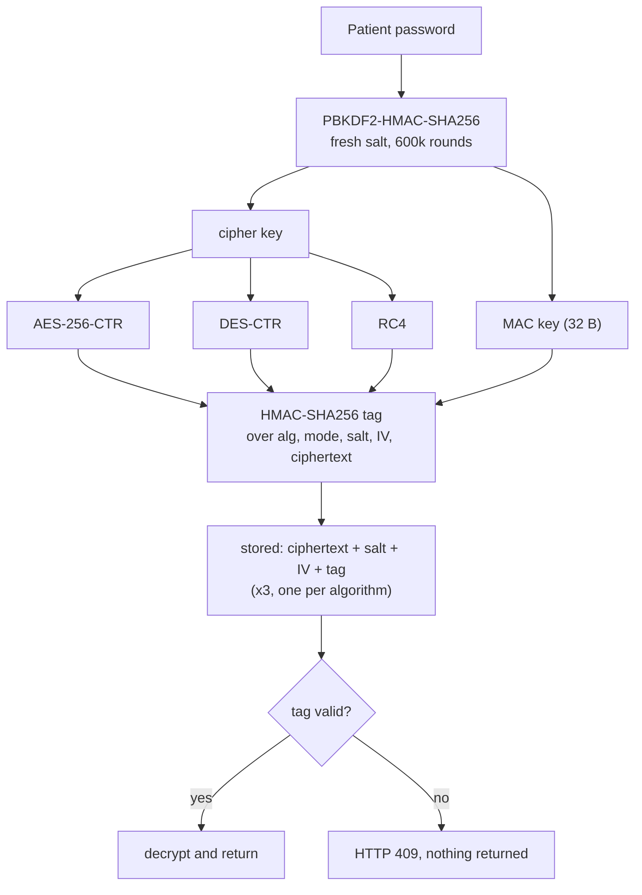

# Implementing AES, DES and RC4 Encryption

This guide explains how Cipher Safe, a **patient-held medical records vault**,
encrypts every patient record with the three required algorithms (**AES**,
**DES** and **RC4**), why each decision was made, and how the pieces fit
together. The working code lives in [`core/crypto/`](../core/crypto) and is
wired to the database in [`core/services.py`](../core/services.py).

## Origin

The cipher core is adapted from the lab reference implementation
[`ukassu/lab-session-information-security`](https://github.com/ukassu/lab-session-information-security)
(`crypto_tool.py`), which provides the PBKDF2 key derivation, PKCS#7 padding and
AES-256-CBC / DES-CBC / RC4 primitives. This project adds the CFB, OFB and CTR
modes, uses CTR for stored data, adds encrypt-then-MAC integrity, and
restructures the code into a framework-free `core/crypto/` package.

## Design goals

- Derive every key from the patient's **password**; never store a key.
- Store each item **three times**, once per algorithm, as the assignment
  requires, so any of the three copies can be decrypted.
- Use a **non-ECB** mode for the block ciphers: **CTR** for both AES and DES.
- Return data **intact or not at all**: every ciphertext carries an
  **HMAC-SHA256** tag that is verified before decryption.
- Keep the primitives **framework-free** so they can be unit-tested and
  benchmarked in isolation.
- Record **timing** per operation (key derivation, cipher, MAC) for the analysis.

## Dependencies

The ciphers come from [PyCryptodome](https://pycryptodome.readthedocs.io/); the
MAC uses Python's standard `hmac` and `hashlib`:

```python
from Crypto.Cipher import AES, ARC4, DES
from Crypto.Util import Counter
from Crypto.Protocol.KDF import PBKDF2
from Crypto.Hash import SHA256
import hashlib, hmac
```

## 1. Key derivation (PBKDF2-HMAC-SHA256)

A password is not usable as a raw key: AES needs 32 bytes, DES 8, and a password
can be any length with little entropy per character. Each operation therefore
derives key material with **PBKDF2-HMAC-SHA256** (600,000 iterations) over a
**fresh random 16-byte salt**. One derivation produces both the cipher key and a
separate 32-byte MAC key ([`keys.py`](../core/crypto/keys.py)):

```python
SALT_SIZE = 16
PBKDF2_ROUNDS = 600_000
MAC_KEY_SIZE = 32

def derive_key(password: str, salt: bytes, length: int) -> bytes:
    if not password:
        raise ValueError("Password must not be empty.")
    if len(salt) != SALT_SIZE:
        raise ValueError("Invalid salt size.")
    return PBKDF2(password, salt, dkLen=length, count=PBKDF2_ROUNDS, hmac_hash_module=SHA256)

def derive_keys(password: str, salt: bytes, cipher_key_size: int) -> tuple[bytes, bytes]:
    material = derive_key(password, salt, cipher_key_size + MAC_KEY_SIZE)
    return material[:cipher_key_size], material[cipher_key_size:]
```

- 600,000 iterations make offline guessing of the password expensive.
- A new salt per operation means the same password never yields the same key
  twice, so identical plaintexts never produce identical ciphertexts.
- The cipher and MAC keys are disjoint slices of one output, so integrity adds
  **no extra derivation cost** and the two keys are never the same bytes.
- The key is never stored. A database dump or a stolen disk alone is useless.

## 2. Algorithm parameters

| Algorithm | Type | Key size | Block / IV | Mode used for stored data | Other modes (benchmark only) |
| --- | --- | --- | --- | --- | --- |
| AES | block cipher | 32 bytes (AES-256) | 16 bytes | **CTR** | CBC, CFB-128, OFB |
| DES | block cipher | 8 bytes (56 effective bits) | 8 bytes | **CTR** | CBC, CFB-64, OFB |
| RC4 | stream cipher | 32 bytes | none | none | none |

```python
SUPPORTED_ALGORITHMS = ("AES", "DES", "RC4")
SUPPORTED_MODES = ("CBC", "CFB", "OFB", "CTR")
DEFAULT_MODE = "CTR"
MODE_FOR = {"AES": "CTR", "DES": "CTR", "RC4": ""}
```

`encrypt()` uses `MODE_FOR[algorithm]` unless a mode is passed explicitly; the
API never lets a client pick the mode, so stored data is always CTR (or RC4).

## 3. Why CTR for both block ciphers

ECB is excluded because identical plaintext blocks give identical ciphertext,
which leaks structure (visible in card-scan images). Among the non-ECB modes,
CTR was chosen because:

1. **No padding**: the ciphertext is exactly as long as the plaintext, which
   matters when every video is stored three times.
2. **Parallelisable and seekable**: any block can be decrypted on its own, so a
   video could be streamed from any offset; it was also the fastest AES mode
   measured (see the report).
3. **Its weakness is covered**: CTR is malleable (flipping ciphertext bit *i*
   flips plaintext bit *i*), but the HMAC (section 6) detects any change. There is
   no padding, so CBC's padding-oracle risk does not arise.
4. **Same mode for AES and DES**: the comparison between them differs only in
   the cipher.

Every encryption uses a fresh salt, hence a fresh key, so the random starting
counter can never repeat under the same key, not even with DES's 64-bit block.

```python
def _block_cipher(algorithm: str, key: bytes, mode: str, iv: bytes):
    module = AES if algorithm == "AES" else DES
    bits = _BLOCK_SIZE[algorithm] * 8
    if mode == "CBC":
        return module.new(key, module.MODE_CBC, iv=iv)
    if mode == "CFB":
        # Full-block CFB; PyCryptodome's 8-bit default was measured ~10x slower.
        return module.new(key, module.MODE_CFB, iv=iv, segment_size=bits)
    if mode == "OFB":
        return module.new(key, module.MODE_OFB, iv=iv)
    if mode == "CTR":
        counter = Counter.new(bits, initial_value=int.from_bytes(iv, "big"))
        return module.new(key, module.MODE_CTR, counter=counter)
    raise ValueError(f"Unsupported mode of operation: {mode}")
```

PyCryptodome's CTR takes no `iv` argument, so the random IV is used as the
initial counter value.

## 4. RC4

RC4 is a **stream** cipher: no mode of operation, no IV, no padding. It is kept
only because the assignment requires it; its keystream has known biases and it
is prohibited in TLS (RFC 7465). It is safe to use without a nonce here only
because every encryption gets a fresh key from a fresh salt.

```python
ciphertext = ARC4.new(key).encrypt(data)
```

## 5. Padding (PKCS#7, CBC only)

Only CBC needs the plaintext length to be a multiple of the block size, and CBC
is used only in the mode benchmark. Stored data (CTR, RC4) is never padded.

```python
def _pkcs7_pad(data: bytes, block_size: int) -> bytes:
    padding = block_size - len(data) % block_size
    return data + bytes([padding]) * padding
```

## 6. Integrity: encrypt-then-MAC (HMAC-SHA256)

None of the three ciphers detects modification, and in CTR and RC4 a wrong key
does not fail: it silently produces wrong plaintext. For medical records, a
silently changed allergy or lab value is a clinical risk, so every ciphertext
gets a 32-byte tag:

```python
_MAC_VERSION = b"cipher-safe/v1"

def _mac(mac_key, algorithm, mode, salt, iv, ciphertext) -> bytes:
    header = b"|".join([_MAC_VERSION, algorithm.encode(), (mode or "-").encode()])
    return hmac.new(mac_key, header + b"|" + salt + (iv or b"") + ciphertext, hashlib.sha256).digest()
```

- The tag covers **everything decryption depends on**. Binding the algorithm
  and mode stops a ciphertext being relabelled (for example, CTR read as OFB).
  The salt and IV have lengths fixed by the algorithm, so the concatenation is
  unambiguous.
- `decrypt()` re-derives the MAC key, compares tags with `hmac.compare_digest`
  (constant time) and only then decrypts. On a mismatch it raises
  `IntegrityError`, and no plaintext is ever produced.
- In the API, the password has already been checked against the user's hash, so
  a tag failure means the **stored data was modified**: the server answers
  **HTTP 409** instead of returning corrupted data.

## 7. Unified `encrypt` / `decrypt` API

```python
def encrypt(data, password, algorithm="AES", mode=None) -> EncryptionResult:
    algorithm, mode = _normalise(algorithm, mode)        # mode defaults to MODE_FOR
    salt = new_salt()
    key, mac_key = derive_keys(password, salt, _KEY_SIZE[algorithm])      # timed: kdf
    if algorithm == "RC4":
        ciphertext = ARC4.new(key).encrypt(data)                          # timed: cipher
    else:
        iv = secrets.token_bytes(_IV_SIZE[algorithm])
        cipher = _block_cipher(algorithm, key, mode, iv)
        payload = _pkcs7_pad(data, _BLOCK_SIZE[algorithm]) if mode == "CBC" else data
        ciphertext = cipher.encrypt(payload)
    tag = _mac(mac_key, algorithm, mode, salt, iv, ciphertext)            # timed: mac
    return EncryptionResult(algorithm, mode, salt, iv, ciphertext, tag, ...)

def decrypt(ciphertext, password, algorithm, salt, iv, mode, tag) -> DecryptionResult:
    # validate sizes -> derive keys -> verify tag (IntegrityError) -> decrypt
```

Both result objects carry `key_derivation_ms`, `cipher_ms` and `mac_ms`
separately. PBKDF2 dominates small items, so a single total would hide the
differences between the ciphers.

## 8. What is stored per ciphertext

Everything except the key, on the abstract `EncryptionEnvelope` model:

| Field | Purpose |
| --- | --- |
| `algorithm` | which cipher to use |
| `mode` | `CTR` for AES/DES, blank for RC4 |
| `salt` | 16 bytes, needed to re-derive the keys |
| `iv` | 16 bytes (AES) or 8 bytes (DES), null for RC4 |
| `tag` | 32-byte HMAC-SHA256 |
| `ciphertext` | inline bytes (profile) or a blob under `media/` (files) |
| `key_derivation_ms`, `cipher_ms`, `mac_ms` | timings for the analysis |

## 9. Wiring it into the app: three ciphertexts per item

```python
def encrypt_with_all_algorithms(data: bytes, password: str):
    return {a: encrypt(data, password, algorithm=a) for a in SUPPORTED_ALGORITHMS}
```

- **Files** (KTP/BPJS scans, medical documents, medical videos): one
  `FileCiphertext` row per algorithm, with the ciphertext written to disk so
  large videos do not bloat the database.
- **Patient profile** (identity and health fields): serialised to **one JSON
  record** and stored as one `EncryptedValue` per algorithm. A save costs 3
  PBKDF2 derivations instead of 3 per field, and it also hides which fields are
  filled in and how long each value is.

## 10. Flow



## 11. Security notes and limitations

- **DES and RC4 are legacy** and are stored only because the assignment requires
  it. Each item is only as confidential as its DES copy (56-bit key); a real
  deployment would keep AES-CTR+HMAC (or AES-GCM) alone.
- **File names and sizes are stored in the clear** to list records; a revealing
  file name can leak health data.
- **No password change or recovery**: keys come from the password, so changing
  it would mean re-encrypting every item, and a forgotten password makes the
  vault unrecoverable by design.
- **The password travels in the `X-Cipher-Password` header**, which is safe only
  over HTTPS. It is held in memory on the client and never written to disk.

## 12. Verifying the implementation

```bash
python manage.py test core
```

The suite checks that every algorithm and mode round-trips, that each algorithm
uses its chosen mode, that a wrong password is rejected for **all three**
ciphers, that flipping a bit in the ciphertext, IV, salt or tag (or relabelling
the mode) is detected, that tampered files and profiles return HTTP 409, and
that uploads download back byte-for-byte under each algorithm.
